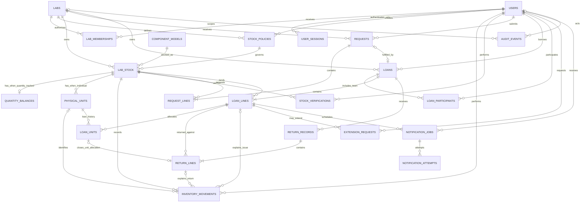

# VInventory database schema

Status: implemented in Drizzle with an initial generated migration

Scope: supports the lending MVP (Phases 1–4), complete single-lab inventory
(Phase 5), and later independent multi-lab operation (Phases 6–7). Optional
Phase 8 workflows such as transfers, kits, and reservations are intentionally
not modeled yet.

## Design decisions

- PostgreSQL is the system of record. Primary keys are UUIDs and business
  timestamps use `timestamptz`.
- Every owned stock record belongs to exactly one lab from its creation.
- A component model is the shared catalogue definition; `lab_stock` records a
  lab's ownership, location, tracking method, and policy for that model.
- Individually tracked equipment uses `physical_units`. Interchangeable or
  measured stock uses `quantity_balances` with `numeric(14,3)` quantities.
- Quantity balances are updated atomically and every change also creates an
  immutable `inventory_movements` row.
- Approval does not alter inventory. Inventory changes only when staff confirm
  issue, return, receipt, consumption, adjustment, or write-off.
- A loan keeps a JSON policy snapshot and its agreed due date. Later edits to a
  stock policy therefore affect only future issues.
- "Overdue" is calculated from `quantity_outstanding > 0` and `due_at`; it is
  not stored as a separate loan state.
- Rows with operational history are retired or deactivated, not deleted.
- VAuth supplies identity only. Lab membership and application authorization
  remain in this database.

## PostgreSQL enums

| Enum | Values |
|---|---|
| `account_type` | `student`, `staff`, `system_admin` |
| `lab_member_role` | `incharge`, `staff` |
| `tracking_method` | `individual`, `quantity` |
| `policy_preset` | `consumable`, `essential`, `project`, `custom` |
| `inventory_status` | `available`, `borrowed`, `awaiting_testing`, `damaged`, `missing`, `retired` |
| `movement_type` | `opening_balance`, `receipt`, `consumption`, `issue`, `return`, `adjustment`, `status_change`, `write_off` |
| `request_status` | `pending`, `approved`, `rejected`, `cancelled`, `fulfilled` |
| `loan_status` | `active`, `partially_returned`, `closed` |
| `return_condition` | `usable`, `untested`, `damaged` |
| `extension_status` | `pending`, `approved`, `rejected`, `cancelled` |
| `notification_kind` | `pre_due`, `due`, `overdue` |
| `notification_status` | `pending`, `processing`, `sent`, `retry`, `cancelled`, `failed` |

## Identity and authorization

### `users`

Local application identity mapped to a stable VAuth subject. No password or
VAuth-internal credential is stored here.

| Column | Type | Rules |
|---|---|---|
| `id` | `uuid` | Primary key |
| `auth_provider` | `text` | Required |
| `auth_subject` | `text` | Required; stable provider identifier |
| `display_name` | `text` | Required |
| `email` | `text` | Optional; not used as identity |
| `account_type` | `account_type` | Required |
| `is_active` | `boolean` | Required, default `true` |
| `created_at` | `timestamptz` | Required |
| `updated_at` | `timestamptz` | Required |

Constraints and indexes:

- Unique: (`auth_provider`, `auth_subject`).
- Index: (`account_type`, `is_active`).

### `user_sessions`

VInventory-owned browser sessions. Only a SHA-256 hash of the random opaque
session token is stored; the browser receives the token in a signed,
HTTP-only cookie.

| Column | Type | Rules |
|---|---|---|
| `id` | `uuid` | Primary key |
| `user_id` | `uuid` | FK `users.id`, required |
| `token_hash` | `text` | Required, unique |
| `expires_at` | `timestamptz` | Required |
| `last_seen_at` | `timestamptz` | Required |
| `revoked_at` | `timestamptz` | Optional |
| `user_agent` | `text` | Optional |
| `ip_hash` | `text` | Optional |
| `created_at` | `timestamptz` | Required |

The API accepts only unexpired, unrevoked sessions belonging to an active
local user. Logout revokes the server-side row before clearing the cookie.

### `labs`

| Column | Type | Rules |
|---|---|---|
| `id` | `uuid` | Primary key |
| `code` | `text` | Required, unique; stable human-readable code |
| `name` | `text` | Required |
| `location` | `text` | Optional |
| `timezone` | `text` | Required; IANA name such as `Asia/Kolkata` |
| `is_active` | `boolean` | Required, default `true` |
| `created_at` | `timestamptz` | Required |
| `updated_at` | `timestamptz` | Required |

### `lab_memberships`

An incharge or authorized staff member can belong to one or more labs. Students
do not need membership rows.

| Column | Type | Rules |
|---|---|---|
| `id` | `uuid` | Primary key |
| `lab_id` | `uuid` | FK `labs.id`, required |
| `user_id` | `uuid` | FK `users.id`, required |
| `role` | `lab_member_role` | Required |
| `can_manage_stock` | `boolean` | Required, default `false` |
| `can_manage_policies` | `boolean` | Required, default `false` |
| `can_approve_requests` | `boolean` | Required, default `false` |
| `can_issue` | `boolean` | Required, default `false` |
| `can_receive` | `boolean` | Required, default `false` |
| `can_export` | `boolean` | Required, default `false` |
| `is_active` | `boolean` | Required, default `true` |
| `created_at` | `timestamptz` | Required |
| `updated_at` | `timestamptz` | Required |

Constraints and indexes:

- Unique: (`lab_id`, `user_id`).
- Index: (`user_id`, `is_active`).
- The service treats an active `incharge` membership as full lab authority;
  explicit permission flags support delegated staff.

## Catalogue, policy, and stock

### `component_models`

Shared exact catalogue definitions. Raspberry Pi memory variants or different
FPGA boards must have different model rows.

| Column | Type | Rules |
|---|---|---|
| `id` | `uuid` | Primary key |
| `model_key` | `text` | Required, unique canonical identifier |
| `manufacturer` | `text` | Optional |
| `name` | `text` | Required |
| `variant` | `text` | Optional |
| `description` | `text` | Optional |
| `specifications` | `jsonb` | Required, default `{}` |
| `search_aliases` | `text[]` | Required, default `{}` |
| `photo_url` | `text` | Optional |
| `is_active` | `boolean` | Required, default `true` |
| `created_at` | `timestamptz` | Required |
| `updated_at` | `timestamptz` | Required |

Indexes:

- GIN index on `search_aliases`.
- Search index over name, manufacturer, variant, and searchable specifications
  can be added when catalogue search is implemented.

### `stock_policies`

Reusable, lab-owned policy presets. The policy name is also the display label,
so labs can define custom categories without weakening validation.

| Column | Type | Rules |
|---|---|---|
| `id` | `uuid` | Primary key |
| `lab_id` | `uuid` | FK `labs.id`, required |
| `name` | `text` | Required |
| `preset` | `policy_preset` | Required |
| `borrower_required` | `boolean` | Required |
| `return_required` | `boolean` | Required |
| `default_loan_days` | `smallint` | Optional; positive when present |
| `approval_required` | `boolean` | Required, default `true` |
| `project_purpose_required` | `boolean` | Required, default `false` |
| `extensions_allowed` | `boolean` | Required, default `false` |
| `is_active` | `boolean` | Required, default `true` |
| `created_by` | `uuid` | FK `users.id`, required |
| `created_at` | `timestamptz` | Required |
| `updated_at` | `timestamptz` | Required |

Constraints:

- Unique: (`lab_id`, `name`).
- A returnable policy must require a borrower and a default loan duration.
- A non-returnable policy must not require a borrower or loan duration.

### `lab_stock`

One lab's holding of a model at a location under a borrowing policy.

| Column | Type | Rules |
|---|---|---|
| `id` | `uuid` | Primary key |
| `lab_id` | `uuid` | FK `labs.id`, required |
| `component_model_id` | `uuid` | FK `component_models.id`, required |
| `policy_id` | `uuid` | FK `stock_policies.id`, required; policy must belong to same lab |
| `stock_code` | `text` | Required; stable code within lab |
| `storage_location` | `text` | Required |
| `unit_of_measure` | `text` | Required; e.g. `piece`, `meter` |
| `allows_fractional_quantity` | `boolean` | Required, default `false` |
| `tracking_method` | `tracking_method` | Required |
| `is_active` | `boolean` | Required, default `true` |
| `created_at` | `timestamptz` | Required |
| `updated_at` | `timestamptz` | Required |

Constraints and indexes:

- Unique: (`lab_id`, `stock_code`).
- Index: (`lab_id`, `component_model_id`, `is_active`).
- A composite FK or service check enforces that `policy_id` belongs to
  `lab_id`.

### `quantity_balances`

Current balance projection for quantity-tracked stock. It is updated in the
same transaction as its movement row.

| Column | Type | Rules |
|---|---|---|
| `stock_id` | `uuid` | PK and FK `lab_stock.id` |
| `available_quantity` | `numeric(14,3)` | Required, default `0` |
| `borrowed_quantity` | `numeric(14,3)` | Required, default `0` |
| `awaiting_testing_quantity` | `numeric(14,3)` | Required, default `0` |
| `damaged_quantity` | `numeric(14,3)` | Required, default `0` |
| `missing_quantity` | `numeric(14,3)` | Required, default `0` |
| `version` | `bigint` | Required, incremented on update |
| `updated_at` | `timestamptz` | Required |

Constraints:

- Every quantity is non-negative.
- The row is permitted only when `lab_stock.tracking_method = quantity`.
- For non-returnable consumables, only `available_quantity` may be non-zero.
- Current owned quantity for returnables is the sum of the five quantity
  buckets. Written-off or retired quantities exist only in movement history.

### `physical_units`

Stable identity and current state for individually tracked boards and tools.

| Column | Type | Rules |
|---|---|---|
| `id` | `uuid` | Primary key |
| `stock_id` | `uuid` | FK `lab_stock.id`, required |
| `asset_tag` | `text` | Required, unique |
| `serial_number` | `text` | Optional |
| `status` | `inventory_status` | Required |
| `condition_notes` | `text` | Optional |
| `acquired_at` | `date` | Optional |
| `retired_at` | `timestamptz` | Required only for retired unit |
| `created_at` | `timestamptz` | Required |
| `updated_at` | `timestamptz` | Required |

Constraints and indexes:

- The parent stock must use `tracking_method = individual`.
- Unique partial index on non-null `serial_number` when the organization can
  guarantee global serial uniqueness; otherwise index it without uniqueness.
- Index: (`stock_id`, `status`).

### `inventory_movements`

Append-only ledger explaining every stock change.

| Column | Type | Rules |
|---|---|---|
| `id` | `uuid` | Primary key |
| `stock_id` | `uuid` | FK `lab_stock.id`, required |
| `physical_unit_id` | `uuid` | FK `physical_units.id`, optional |
| `movement_type` | `movement_type` | Required |
| `quantity` | `numeric(14,3)` | Required, positive |
| `from_status` | `inventory_status` | Optional |
| `to_status` | `inventory_status` | Optional |
| `actor_user_id` | `uuid` | FK `users.id`, required |
| `loan_line_id` | `uuid` | FK `loan_lines.id`, optional |
| `return_line_id` | `uuid` | FK `return_lines.id`, optional |
| `reason` | `text` | Required for adjustment/write-off; otherwise optional |
| `purpose` | `text` | Optional; useful for consumable issue |
| `idempotency_key` | `text` | Required, unique |
| `occurred_at` | `timestamptz` | Required |

Constraints:

- A movement for a physical unit has `quantity = 1`.
- `consumption` has no loan reference and moves available quantity out of
  current stock.
- `issue` and `return` movements reference the relevant loan/return lines.
- Rows are never updated or deleted; reversals use a compensating movement.

### `stock_verifications`

Physical-count history. Any reconciliation is recorded separately as one or
more adjustment movements.

| Column | Type | Rules |
|---|---|---|
| `id` | `uuid` | Primary key |
| `stock_id` | `uuid` | FK `lab_stock.id`, required |
| `verified_by` | `uuid` | FK `users.id`, required |
| `counted_available` | `numeric(14,3)` | Required |
| `counted_borrowed` | `numeric(14,3)` | Required, default `0` |
| `counted_awaiting_testing` | `numeric(14,3)` | Required, default `0` |
| `counted_damaged` | `numeric(14,3)` | Required, default `0` |
| `counted_missing` | `numeric(14,3)` | Required, default `0` |
| `notes` | `text` | Optional |
| `verified_at` | `timestamptz` | Required |

Index: (`stock_id`, `verified_at DESC`). The latest row supplies the displayed
last-verification date.

## Requests and lending

### `requests`

| Column | Type | Rules |
|---|---|---|
| `id` | `uuid` | Primary key |
| `lab_id` | `uuid` | FK `labs.id`, required; owning lab |
| `requested_by` | `uuid` | FK `users.id`, required |
| `status` | `request_status` | Required |
| `reviewed_by` | `uuid` | FK `users.id`, optional |
| `reviewed_at` | `timestamptz` | Optional |
| `decision_reason` | `text` | Optional |
| `created_at` | `timestamptz` | Required |
| `updated_at` | `timestamptz` | Required |

Approval changes only request state. It does not alter a stock balance.

### `request_lines`

| Column | Type | Rules |
|---|---|---|
| `id` | `uuid` | Primary key |
| `request_id` | `uuid` | FK `requests.id`, required |
| `stock_id` | `uuid` | FK `lab_stock.id`, required; same lab as request |
| `quantity_requested` | `numeric(14,3)` | Required, positive |
| `quantity_fulfilled` | `numeric(14,3)` | Required, default `0` |
| `project_purpose` | `text` | Optional/required by policy |
| `desired_due_at` | `timestamptz` | Optional |

Constraint: `0 <= quantity_fulfilled <= quantity_requested`.

### `loans`

A confirmed handover. Staff may create it directly or from an approved request.

| Column | Type | Rules |
|---|---|---|
| `id` | `uuid` | Primary key |
| `lab_id` | `uuid` | FK `labs.id`, required |
| `borrower_user_id` | `uuid` | FK `users.id`, required |
| `source_request_id` | `uuid` | FK `requests.id`, optional |
| `status` | `loan_status` | Required |
| `issued_by` | `uuid` | FK `users.id`, required |
| `issued_at` | `timestamptz` | Required |
| `notes` | `text` | Optional |
| `idempotency_key` | `text` | Required, unique |
| `created_at` | `timestamptz` | Required |
| `updated_at` | `timestamptz` | Required |

### `loan_participants`

Optional project-team members associated with a loan. These users do not
replace `loans.borrower_user_id`, who remains the responsible borrower.

| Column | Type | Rules |
|---|---|---|
| `loan_id` | `uuid` | PK part and FK `loans.id` |
| `user_id` | `uuid` | PK part and FK `users.id` |
| `created_at` | `timestamptz` | Required |

Constraint: the responsible borrower is not duplicated as a participant.

### `loan_lines`

| Column | Type | Rules |
|---|---|---|
| `id` | `uuid` | Primary key |
| `loan_id` | `uuid` | FK `loans.id`, required |
| `stock_id` | `uuid` | FK `lab_stock.id`, required; same lab as loan |
| `quantity_issued` | `numeric(14,3)` | Required, positive |
| `quantity_outstanding` | `numeric(14,3)` | Required |
| `due_at` | `timestamptz` | Required |
| `due_revision` | `integer` | Required, default `1` |
| `project_purpose` | `text` | Optional/required by policy snapshot |
| `issue_condition` | `text` | Optional |
| `policy_snapshot` | `jsonb` | Required; immutable issue-time policy |
| `created_at` | `timestamptz` | Required |
| `updated_at` | `timestamptz` | Required |

Constraints and indexes:

- `0 <= quantity_outstanding <= quantity_issued`.
- Index: (`stock_id`, `due_at`) where `quantity_outstanding > 0`.
- Index: (`loan_id`).

### `loan_units`

Physical-unit allocation for individually tracked loan lines.

| Column | Type | Rules |
|---|---|---|
| `id` | `uuid` | Primary key |
| `loan_line_id` | `uuid` | FK `loan_lines.id`, required |
| `physical_unit_id` | `uuid` | FK `physical_units.id`, required |
| `returned_at` | `timestamptz` | Optional; set only after staff confirmation |

Constraints:

- Unique: (`loan_line_id`, `physical_unit_id`).
- Partial unique: (`physical_unit_id`) where `returned_at IS NULL`. This is the
  database guard against overlapping active loans for an identified unit.

### `return_records`

One staff-confirmed receipt event, which can contain a full or partial return.

| Column | Type | Rules |
|---|---|---|
| `id` | `uuid` | Primary key |
| `loan_id` | `uuid` | FK `loans.id`, required |
| `received_by` | `uuid` | FK `users.id`, required |
| `received_at` | `timestamptz` | Required |
| `notes` | `text` | Optional |
| `idempotency_key` | `text` | Required, unique |

### `return_lines`

| Column | Type | Rules |
|---|---|---|
| `id` | `uuid` | Primary key |
| `return_record_id` | `uuid` | FK `return_records.id`, required |
| `loan_line_id` | `uuid` | FK `loan_lines.id`, required |
| `loan_unit_id` | `uuid` | FK `loan_units.id`, optional |
| `quantity` | `numeric(14,3)` | Required, positive |
| `condition` | `return_condition` | Required |
| `destination_status` | `inventory_status` | Must be `available`, `awaiting_testing`, or `damaged` |
| `condition_notes` | `text` | Optional |

Constraints:

- A unit return has `quantity = 1` and a `loan_unit_id`.
- A non-null `loan_unit_id` is unique so the same allocation cannot be returned
  twice.
- The total confirmed returned quantity cannot exceed the loan line's current
  outstanding quantity.
- `usable` normally maps to `available`; `untested` and `damaged` never do.

### `extension_requests`

| Column | Type | Rules |
|---|---|---|
| `id` | `uuid` | Primary key |
| `loan_line_id` | `uuid` | FK `loan_lines.id`, required |
| `requested_by` | `uuid` | FK `users.id`, required |
| `previous_due_at` | `timestamptz` | Required |
| `requested_due_at` | `timestamptz` | Required; later than previous date |
| `reason` | `text` | Required |
| `status` | `extension_status` | Required |
| `reviewed_by` | `uuid` | FK `users.id`, optional |
| `reviewed_at` | `timestamptz` | Optional |
| `decision_reason` | `text` | Optional |
| `created_at` | `timestamptz` | Required |

On approval, `loan_lines.due_at` is updated, `due_revision` increments, and
obsolete notification jobs are cancelled in the same transaction.

Partial unique index: at most one `pending` extension request per loan line.

## Notifications and audit

### `notification_jobs`

Persistent scheduled work; browser sessions are not used as schedulers.

| Column | Type | Rules |
|---|---|---|
| `id` | `uuid` | Primary key |
| `loan_line_id` | `uuid` | FK `loan_lines.id`, required |
| `due_revision` | `integer` | Required |
| `kind` | `notification_kind` | Required |
| `recipient_user_id` | `uuid` | FK `users.id`, required |
| `channel` | `text` | Required |
| `scheduled_at` | `timestamptz` | Required |
| `status` | `notification_status` | Required |
| `attempt_count` | `integer` | Required, default `0` |
| `next_attempt_at` | `timestamptz` | Optional |
| `claimed_at` | `timestamptz` | Optional |
| `sent_at` | `timestamptz` | Optional |
| `created_at` | `timestamptz` | Required |
| `updated_at` | `timestamptz` | Required |

Constraints and indexes:

- Unique logical job: (`loan_line_id`, `due_revision`, `kind`,
  `recipient_user_id`, `channel`).
- Claiming index: (`status`, `next_attempt_at`, `scheduled_at`).

### `notification_attempts`

| Column | Type | Rules |
|---|---|---|
| `id` | `uuid` | Primary key |
| `job_id` | `uuid` | FK `notification_jobs.id`, required |
| `attempt_number` | `integer` | Required |
| `started_at` | `timestamptz` | Required |
| `finished_at` | `timestamptz` | Optional |
| `outcome` | `text` | Required |
| `provider_message_id` | `text` | Optional |
| `error_code` | `text` | Optional |
| `error_detail` | `text` | Optional; sanitized |

Unique: (`job_id`, `attempt_number`).

### `audit_events`

Append-only record of security-sensitive and business changes. It complements,
but does not replace, the inventory movement ledger.

| Column | Type | Rules |
|---|---|---|
| `id` | `uuid` | Primary key |
| `lab_id` | `uuid` | FK `labs.id`, optional for system events |
| `actor_user_id` | `uuid` | FK `users.id`, optional for system events |
| `action` | `text` | Required |
| `entity_type` | `text` | Required |
| `entity_id` | `uuid` | Required |
| `before_data` | `jsonb` | Optional |
| `after_data` | `jsonb` | Optional |
| `correlation_id` | `uuid` | Required; groups one transaction/request |
| `occurred_at` | `timestamptz` | Required |

Indexes: (`lab_id`, `occurred_at DESC`), (`entity_type`, `entity_id`), and
(`correlation_id`). Audit rows are never modified or deleted by application
users.

## Transaction invariants

These rules must be implemented in API service transactions and reinforced by
the constraints/indexes above:

1. **Quantity issue:** lock or conditionally update `quantity_balances`, reject
   insufficient availability, create the loan line, decrement available,
   increment borrowed, append a movement, and enqueue reminder jobs atomically.
2. **Individual issue:** atomically change each unit from `available` to
   `borrowed`; the partial unique `loan_units` index prevents overlap.
3. **Return:** lock the loan line, reject excess quantity, append return and
   movement rows, reduce outstanding/borrowed, and send the stock to available,
   awaiting-testing, or damaged according to staff-confirmed condition.
4. **Consumable issue:** conditionally decrement available quantity and append a
   `consumption` movement. Do not create a request, borrower, due date, or loan.
5. **Request approval:** update only the request. Recheck stock during handover.
6. **Policy change:** update the policy for future use. Never rewrite existing
   `loan_lines.policy_snapshot`.
7. **Extension:** preserve `previous_due_at`, increment `due_revision`, cancel
   obsolete jobs, and schedule replacement jobs atomically.
8. **Corrections and write-offs:** require a reason, responsible staff actor,
   movement entry, and audit event.
9. **Idempotency:** issue, return, and movement-producing endpoints must reuse a
   client operation key so retries cannot duplicate business actions.

## Deletion and retention

- Users, labs, models, policies, and stock are deactivated instead of deleted.
- Loans, returns, extensions, movements, notification attempts, verifications,
  and audit events are immutable historical records.
- Foreign keys to historical records use `ON DELETE RESTRICT`.
- Personally identifying fields can be subject to a later retention policy,
  but custody and audit records must remain referentially valid.

## ER diagram

The editable Mermaid source is in [`er-diagram.mmd`](./er-diagram.mmd).

## Decisions still requiring pilot confirmation

The schema deliberately leaves these as configuration or service-level choices:

- Which reminder channels are available.
- Whether the MVP begins with student requests or direct staff checkout.
- The pilot lab's default policy durations and delegated permissions.
- Whether serial numbers are globally unique enough to enforce with a unique
  index.
- Retention periods for personal data, audit logs, and notification attempts.
